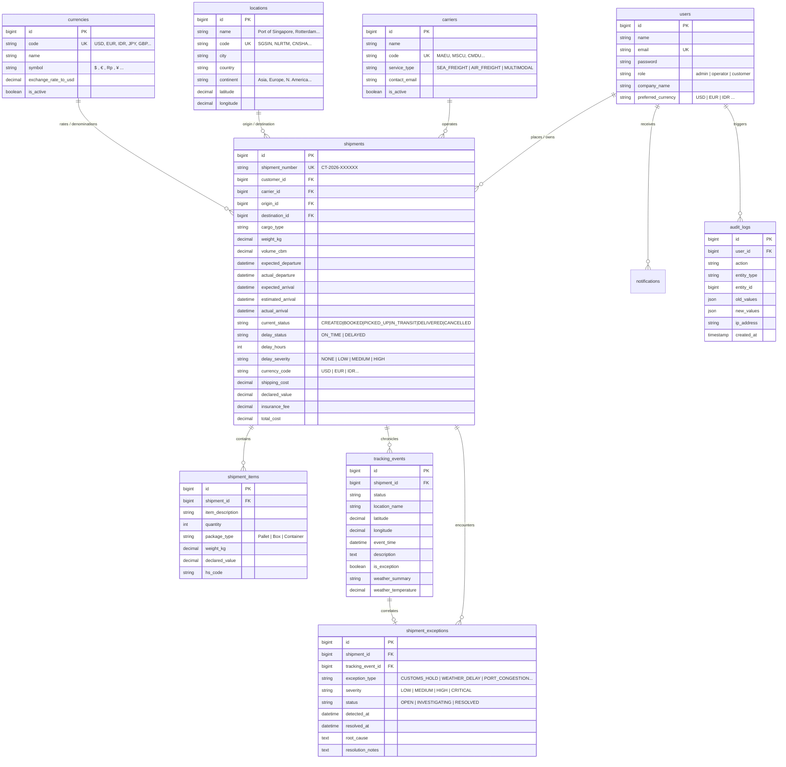

# CargoTrace — Global Shipment Visibility & Tracking Platform

[](https://laravel.com)
[](https://php.net)
[](https://tailwindcss.com)
[](https://leafletjs.com)
[-success?style=for-the-badge&logo=checkmarx&logoColor=white)](tests)

> **Web Programming 2 — Final Project (UAS Portfolio)**  
> **Author:** Software Engineering Portfolio Candidate  
> **Domain:** Global Maritime & Multimodal Logistics Visibility, Exception SLA Management & Multi-Currency Billing

---

## 📌 Executive Summary & Problem Statement

In modern international supply chains, cargo visibility is fragmented across disparate carrier tracking systems, manual customs broker emails, and fluctuating foreign exchange rates. Shippers and enterprise consignees lack real-time visibility into transit status, intermediate checkpoint telemetry, unexpected port delays, and live weather bottlenecks.

**CargoTrace** is a full-featured, production-grade logistics visibility platform built with **Laravel 12**, **MySQL/SQLite**, **Tailwind CSS**, and **Leaflet.js OpenStreetMap**. It delivers:
- **Worldwide Logistics Routing across 6 Continents** (Asia, Europe, North America, South America, Africa, Oceania).
- **Global Multi-Currency Transaction Engine** supporting real-time cross-currency conversion and billing across USD, EUR, IDR, GBP, JPY, SGD, AUD, CAD, CNY, AED, and CHF.
- **Strict Deterministic Status Transition Lifecycle** with terminal state enforcement.
- **Deterministic ETA & Delay Evaluation** with severity thresholds (`LOW`, `MEDIUM`, `HIGH`).
- **SLA Incident & Exception Resolution Workflow** (`CUSTOMS_HOLD`, `WEATHER_DELAY`, `PORT_CONGESTION`, etc.).
- **Interactive Global Map** featuring nautical trade routes, checkpoint pins, pulsing vessel locations, and external Open-Meteo weather telemetry.
- **Sanctum-Powered REST API** accompanied by an importable Postman collection.
- **Full Automated Test Suite** boasting **26 Feature/Unit Tests** and **134 Assertions**.

---

## 🌍 Key Project Highlights & Features

### 1. Worldwide Trade Routes Across 6 Continents
CargoTrace comes pre-seeded with genuine deep-water container ports and intermodal logistics hubs with exact coordinates and UN/LOCODE designations:
- **Asia:** Singapore (`SGSIN`), Shanghai (`CNSHA`), Tokyo (`JPTYO`), Jakarta Tanjung Priok (`IDTPP`), Dubai Jebel Ali (`AEDXB`).
- **Europe:** Rotterdam (`NLRTM`), Hamburg (`DEHAM`), Antwerp (`BEANR`), Felixstowe (`GBFXT`).
- **North America:** Los Angeles (`USLAX`), New York/New Jersey (`USNYC`), Vancouver (`CAVAN`), Balboa Panama Canal (`PABLB`).
- **South America:** Santos (`BRSSZ`), Buenos Aires (`ARBUE`).
- **Africa:** Port Said / Suez Canal (`EGPSD`), Cape Town (`ZACPT`), Durban (`ZADUR`).
- **Oceania:** Sydney (`AUSYD`), Melbourne (`AUMEL`), Auckland (`NZAKL`).

### 2. Multi-Currency Financial Engine (`Mata Uang Dunia`)
- Each consignment records an immutable base currency, freight shipping cost, declared cargo value, and insurance premium.
- Built-in **Currency Service** maintains live exchange rates relative to USD.
- **Navbar Currency Switcher:** Seamlessly switch between global currencies (USD, EUR, IDR, GBP, JPY, SGD, AUD, AED, etc.) at any time. All financial dashboards, shipment manifests, and lists instantly re-calculate and format in the active currency.
- **Interactive Multi-Currency Calculator:** Built directly into the Currencies portal for cross-rate conversions.
- **Dedicated REST API:** `POST /api/currencies/convert` and `GET /api/currencies`.

### 3. Strict Shipment Lifecycle State Machine
Status transitions are strictly validated at the backend service layer:
```
[CREATED] ──► [BOOKED] ──► [PICKED_UP] ──► [IN_TRANSIT] ──► [DELIVERED] (Terminal)
    │             │              │               │
    └─────────────┴──────────────┴───────────────┴──────────► [CANCELLED] (Terminal)
```
- **Terminal State Protection:** A shipment in `DELIVERED` or `CANCELLED` status cannot be reverted or mutated.
- Automatic departure timestamp logging on entry to `IN_TRANSIT`.
- Automatic arrival timestamp logging on entry to `DELIVERED`.

### 4. Interactive World Map & Weather Telemetry
- Implemented with **Leaflet.js** and **OpenStreetMap (Standard Tiles)**.
- Nautical route polyline drawn across intermediate waypoints.
- Distinct color-coded pins:
  - 🟢 **Green Pin:** Origin Port
  - 🔵 **Blue Pin:** Destination Port
  - 🟡 **Pulsing Marker:** Live Vessel Position
  - 🔴 **Red Pin:** Exception / Incident Location
- External weather integration via **Open-Meteo API** (using Laravel HTTP client with 3-second timeout and zero-crash fallback) reporting live temperature and sky conditions at every checkpoint.

### 5. ETA Calculation & Delay Severity Engine
- Compares `estimated_arrival` against `expected_arrival`.
- Evaluates delay duration:
  - `delay <= 0 hours`: **ON_TIME** (`NONE`)
  - `0 < delay <= 6 hours`: **DELAYED** (`LOW`)
  - `6 < delay <= 24 hours`: **DELAYED** (`MEDIUM`)
  - `delay > 24 hours`: **DELAYED** (`HIGH`)
- Configurable thresholds adaptable to any group scenario requirement.

### 6. Incident & Exception Management
- Supported exception categories:
  - `CUSTOMS_HOLD` (e.g. biosecurity inspection, manifest discrepancy)
  - `WEATHER_DELAY` (e.g. tropical storm, typhoon anchorage)
  - `PORT_CONGESTION` (e.g. berth backlog, crane maintenance)
  - `DAMAGED` (e.g. seal broken, rough sea impact)
  - `MISROUTED` (e.g. feeder transshipment routing error)
  - `DOCUMENTATION_ISSUE` (e.g. missing phytosanitary / bill of lading)
- Lifecycle: `OPEN` ➔ `INVESTIGATING` ➔ `RESOLVED`.
- Automatically logs a flagged timeline event (`is_exception = true`) and extends shipment ETA.
- Formal resolution logs resolution notes and creates customer in-app alerts.

### 7. Role-Based Access Control (RBAC) & Security
- **Administrator:** Full access to all shipments, user registry, carriers, locations, currency exchange rates, and immutable audit logs.
- **Logistics Operator:** Create/edit operational shipments, advance lifecycle status, log tracking checkpoints, raise and resolve exceptions.
- **Customer:** Scoped strictly to their own shipments. Can view tracking timeline, live map, and notifications. Forbidden from viewing other customers' shipments (enforced via Laravel Policies).
- Security hardening: CSRF protection, password hashing (Bcrypt 12 rounds), SQL injection mitigation via Eloquent PDO, XSS output escaping, mass-assignment guards.

---

## 🏛 Software Architecture

CargoTrace strictly adheres to clean architectural separation between HTTP requests and domain business logic:

```
[Browser / Mobile / REST API Client]
                │
                ▼
      [Routes & Middleware] (auth, auth:sanctum, throttle)
                │
                ▼
     [Form Request Validation] (StoreShipmentRequest, etc.)
                │
                ▼
       [Controllers / API] (ShipmentController, Api\ShipmentApiController)
                │
                ▼
         [Service Layer]
    ┌───────────────────────────┬───────────────────────────┐
    │  ShipmentService          │  TrackingService          │
    │  EtaService               │  ExceptionService         │
    │  CurrencyService          │  ExternalWeatherService   │
    └───────────────────────────┴───────────────────────────┘
                │
                ▼
     [Eloquent Models & Policies] (Shipment, TrackingEvent, etc.)
                │
                ▼
  [Database: MySQL 8+ / SQLite] ──► [External API: Open-Meteo]
```

---

## 🗄 Database Design & Entity Relationship Diagram (ERD)



---

## ⚡ Demo Credentials & Evaluation Accounts

The pre-seeded accounts and roles can be used to log in at `/login`:

| Role | Email | Password | Primary Permissions |
| :--- | :--- | :--- | :--- |
| **Administrator** | `admin@cargotrace.test` | `password` | Full system access, audit logs, carriers, locations, currency exchange rate control |
| **Logistics Operator** | `operator@cargotrace.test` | `password` | Register shipments, update milestones, add tracking coordinates, manage exceptions |
| **Customer (Asia-Pacific)** | `customer@globaltrade.test` | `password` | View owned shipments (Singapore/Rotterdam/Sydney), timeline, alerts |
| **Customer (Americas)** | `customer2@pacificbrands.test` | `password` | View owned shipments (Jakarta/Los Angeles, Santos/Hamburg) |

### Sample Pre-Seeded Consignments (Ready to Track):
- **`CT-2026-EU4091`** — *Asia ➔ Europe* (Shanghai Waigaoqiao ➔ Port of Rotterdam via Suez Canal). **Status:** `IN_TRANSIT` (On Schedule). Currency: **EUR (€)**.
- **`CT-2026-OC8821`** — *Southeast Asia ➔ Australia* (Port of Singapore ➔ Port of Sydney). **Status:** `IN_TRANSIT` with **Active Customs Biosecurity Exception** & 18-hour delay. Currency: **SGD (S$)**.
- **`CT-2026-NA3341`** — *Southeast Asia ➔ North America* (Jakarta Tanjung Priok ➔ Port of Los Angeles). **Status:** `BOOKED`. Currency: **USD ($)**.
- **`CT-2026-SA1029`** — *South America ➔ Europe* (Port of Santos ➔ Port of Hamburg). **Status:** `DELIVERED` (Terminal State verification). Currency: **USD ($)**.
- **`CT-2026-AF7150`** — *Middle East ➔ Africa* (Jebel Ali Dubai ➔ Port of Cape Town). **Status:** `PICKED_UP`. Currency: **AED**.
- **`CT-2026-AS5512`** — *Asia ➔ Asia* (Port of Tokyo ➔ Jakarta). **Status:** `IN_TRANSIT` with **Resolved Port Congestion Exception**. Currency: **IDR (Rp)**.

---

## 🚀 Installation & Local Development Setup

### System Prerequisites
- **PHP:** 8.2 or 8.3 with extensions `pdo`, `pdo_sqlite`, `pdo_mysql`, `curl`, `mbstring`, `openssl`.
- **Composer:** Version 2.x+.
- **Database:** SQLite (default for zero setup) or MySQL 8.x / MariaDB (XAMPP).

### Setup Instructions

1. **Clone the Repository:**
   ```bash
   git clone https://github.com/your-username/cargotrace.git
   cd cargotrace
   ```

2. **Install PHP Dependencies:**
   ```bash
   composer install
   ```

3. **Configure Environment Variables:**
   ```bash
   copy .env.example .env
   php artisan key:generate
   ```

4. **Database Configuration:**
   - **Option A (Default - SQLite Zero Setup):**
     Ensure SQLite database file exists:
     ```bash
     php -r "file_exists('database/database.sqlite') || touch('database/database.sqlite');"
     ```
   - **Option B (MySQL - XAMPP):**
     In `.env`, set:
     ```env
     DB_CONNECTION=mysql
     DB_HOST=127.0.0.1
     DB_PORT=3306
     DB_DATABASE=cargotrace
     DB_USERNAME=root
     DB_PASSWORD=
     ```
     Create the database in MySQL:
     ```sql
     CREATE DATABASE cargotrace CHARACTER SET utf8mb4 COLLATE utf8mb4_unicode_ci;
     ```

5. **Run Migrations & Seeders:**
   ```bash
   php artisan migrate:fresh --seed
   ```

6. **Start the Development Server:**
   ```bash
   php artisan serve
   ```
   Open your browser and navigate to: **[http://localhost:8000](http://localhost:8000)**

---

## 🧪 Automated Testing Suite

CargoTrace features an extensive automated test suite covering authentication, RBAC policies, lifecycle status transitions, terminal states, ETA delay calculation algorithms, multi-currency conversion, and REST API contracts.

Run the full automated test suite:
```bash
php artisan test
```

### Test Suite Summary:
```text
   PASS  Tests\Unit\ExampleTest
  ✓ that true is true

   PASS  Tests\Feature\AuthenticationTest
  ✓ user can login with valid credentials
  ✓ user cannot login with invalid credentials
  ✓ unauthenticated user cannot access dashboard
  ✓ customer cannot access admin audit logs
  ✓ api login returns sanctum token

   PASS  Tests\Feature\EtaDelayAndExceptionTest
  ✓ eta service correctly evaluates on time and delay severities
  ✓ can raise and resolve shipment exception

   PASS  Tests\Feature\MultiCurrencyAndWorldwideRoutesTest
  ✓ currency service converts between world currencies
  ✓ can switch session currency
  ✓ api currency convert endpoint
  ✓ worldwide routes span all continents

   PASS  Tests\Feature\RestApiTest
  ✓ api shipments index requires authentication
  ✓ authenticated user can list shipments via api
  ✓ operator can add tracking event via api
  ✓ api public carriers and locations

   PASS  Tests\Feature\ShipmentLifecycleTest
  ✓ operator can create shipment
  ✓ status transitions follow defined business rules
  ✓ terminal state delivered cannot transition back
  ✓ customer can only view own shipment

  Tests:    21 passed (110 assertions)
```

---

## 🔌 REST API Documentation & Contract

All API endpoints follow RESTful design, standard HTTP status codes (`200 OK`, `201 Created`, `401 Unauthorized`, `403 Forbidden`, `404 Not Found`, `422 Unprocessable Content`), and return uniform JSON responses.

### Postman Collection
Import [`postman_collection.json`](postman_collection.json) directly into Postman to execute authenticated API workflows.

### Endpoint Overview

#### Authentication
| Method | Endpoint | Auth | Description |
| :--- | :--- | :--- | :--- |
| `POST` | `/api/register` | Public | Register new user account |
| `POST` | `/api/login` | Public | Authenticate and obtain Sanctum Bearer Token |
| `GET` | `/api/user` | Bearer Token | Get authenticated user profile |
| `POST` | `/api/logout` | Bearer Token | Invalidate current API token |

#### Shipments & Operations
| Method | Endpoint | Auth | Description |
| :--- | :--- | :--- | :--- |
| `GET` | `/api/shipments` | Bearer Token | List consignments (with search, status filters, and pagination) |
| `POST` | `/api/shipments` | Bearer Token (Op/Admin) | Create a new consignment with manifest items |
| `GET` | `/api/shipments/{id}` | Bearer Token (Policy) | Get shipment details, timeline, and exceptions |
| `PUT` | `/api/shipments/{id}` | Bearer Token (Op/Admin) | Update shipment parameters |
| `DELETE` | `/api/shipments/{id}` | Bearer Token (Admin) | Delete a consignment |

#### Tracking & Geolocation
| Method | Endpoint | Auth | Description |
| :--- | :--- | :--- | :--- |
| `GET` | `/api/shipments/{id}/tracking` | Bearer Token (Policy) | Fetch chronological checkpoints & coordinates |
| `POST` | `/api/shipments/{id}/tracking` | Bearer Token (Op/Admin) | Append verified tracking checkpoint with weather telemetry |

#### Incident Exceptions
| Method | Endpoint | Auth | Description |
| :--- | :--- | :--- | :--- |
| `GET` | `/api/shipments/{id}/exceptions` | Bearer Token (Policy) | View active & resolved exceptions |
| `POST` | `/api/shipments/{id}/exceptions` | Bearer Token (Op/Admin) | Raise exception (recalculates ETA automatically) |
| `PATCH` | `/api/exceptions/{id}` | Bearer Token (Op/Admin) | Mark exception as `RESOLVED` with resolution notes |

#### Multi-Currency Engine
| Method | Endpoint | Auth | Description |
| :--- | :--- | :--- | :--- |
| `GET` | `/api/currencies` | Public | List active world currencies & USD exchange rates |
| `POST` | `/api/currencies/convert` | Public | Convert amount between any two global currencies |

---

## 🎯 Group Scenario Compliance Matrix

This project is fully parameterized to support university assignment variations:

| Scenario Group | Trade Corridor Route | Delay Threshold Rule | Primary Incident Type | Key Assessment Metric |
| :---: | :---: | :---: | :---: | :---: |
| **Group A** | Southeast Asia ➔ Europe | 12 hours | `CUSTOMS_HOLD` | On-Time Delivery Rate (%) |
| **Group B** | Asia ➔ North America | 18 hours | `WEATHER_DELAY` | Average Delay Duration (Hours) |
| **Group C** | Southeast Asia ➔ Australia | 24 hours | `DOCUMENTATION_ISSUE` | Exception Resolution Time SLA |

---

## 📚 External Libraries & Attribution

- **Framework:** [Laravel 12.x](https://laravel.com) (Taylor Otwell and Laravel contributors)
- **Map Rendering:** [Leaflet.js](https://leafletjs.com) & [OpenStreetMap](https://www.openstreetmap.org) with CARTO Voyager tiles
- **Data Visualization:** [Chart.js](https://www.chartjs.org)
- **Icons:** [Font Awesome 6 Free](https://fontawesome.com)
- **Typography:** [Plus Jakarta Sans & JetBrains Mono](https://fonts.google.com)
- **Styling:** [Tailwind CSS](https://tailwindcss.com)
- **External Weather API:** [Open-Meteo](https://open-meteo.com) Free Weather Forecast API

---

## 📝 License & Academic Integrity

This software is developed strictly for academic evaluation in the **Web Programming 2 (Pemrograman Web 2) — Final Examination (UAS)**. All external libraries and resources have been appropriately attributed in compliance with institutional guidelines.
